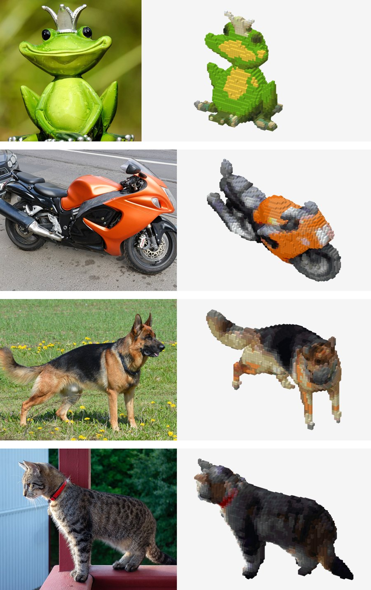

# mcstatue

Turns a photo into a Minecraft statue. Runs on CPU.

```
pip install git+https://github.com/salw2e/mcstatue
mcstatue dog.jpg
```

This makes `dog.schem` and a preview picture `dog.png`. Put the schem in `plugins/WorldEdit/schematics`, then `//schem load dog` and `//paste` in game. The first run downloads about 2 GB of models.

```
mcstatue dog.jpg --height 96
mcstatue dog.jpg --blocks wool,concrete
mcstatue dog.jpg --solid
```

<picture>
  <source media="(min-width: 768px)" srcset="docs/statues-wide.jpg">
  
</picture>

Takes about 20 seconds and 4 GB of RAM on a 12 core CPU. Works best with a side or three quarter photo of one thing. The back of the statue is a guess.

The 3D shape comes from [TripoSR](https://github.com/VAST-AI-Research/TripoSR) (MIT, in `tsr/`). The photos above are CC0 from Wikimedia Commons.
